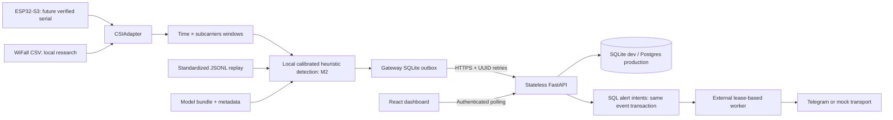

# Architecture

The edge owns all raw CSI, windowing, inference and buffering. The ESP32 does not post to the cloud in v1. The API owns anonymous events, zone configuration and event-derived status. The browser polls every three seconds; there are no WebSockets or background tasks inside serverless functions. M2 uses complete standardized windows and a local calibration; raw packet assembly is still future work. See [M2 state and schedule behavior](M2_DETECTION.md).

`contracts/` is the only shared web/event schema dependency. `detection/` has no backend or HTTP imports. `gateway/` connects inference to delivery and allocates sequences transactionally. `.gateway/` is durable local edge state, never deployed API storage. PostgreSQL constraints, not in-memory caches, guarantee API idempotency.

Adapters return a finite float64 `(1, subcarriers)` row; stacked rows form `(time, subcarriers)` windows. Config determines sample rate, window length, subcarrier order, amplitude/phase, complex pair order, invalid-byte removal and section ranges. Config fingerprints bind these choices to artifacts. No algorithm assumes the WiFall dimensions or rate. Phase here is raw angle; phase calibration/unwrapping is later preprocessing.

M3 trains logistic regression and a small temporal CNN with recording/participant split isolation. Dataset preparation averages repeated timestamps and resamples within continuous segments, never across configured gaps. Numeric weights, train-only standardizers and metadata are saved atomically in a single ZIP bundle. `ModelPredictor` routes through `load_model` and enforces the input contract for every subsequent window, using NumPy without sklearn/Torch in the gateway. Optional predictions annotate events and do not alter M2 state decisions. Rate metadata must describe validated acquisition timing or explicit resampling, not merely a guessed config value. See [M3](M3_ML.md).

Production boundaries still to validate: device-scoped credentials and provisioning, database migrations and indexing under realistic load, rate/body limits at the proxy, real serial packet assembly and timing, future clock skew, retention, outbox disk limits, alert delivery and deployment packaging.

M5 adds an explicit additive schema setup, API body/future-time limits, bounded gateway queue capacity, TLS/secret/origin startup guards, authenticated readiness, minimal API packaging and durable alert intents. The external worker claims expiring SQL leases, performs networking outside the transaction and records retry/dead/expired outcomes. A source UUID queues at most one intent, but a lost Telegram acknowledgement can duplicate the external message. Mock mode performs no networking. Current replay is excluded from real delivery. No alert thread runs inside a serverless handler. See [deployment and remaining acceptance checks](M5_DEPLOYMENT.md); hosted execution remains pending.

M4 `research/` reads local prepared datasets and fixed M3 artifacts. Privacy attacker weights stay local and are rejected by the activity inference loader. Robustness fits its anomaly references only on training partitions. Optional `--tamper-model` adds statistical anomaly events through the existing gateway outbox without changing fall or occupancy states. `identity/` is a separate default-off CLI with consent, local templates and deletion; neither backend nor gateway imports it. The event schema rejects known identity fields recursively while remaining extensible for anonymous metadata. See [M4 methods and boundaries](M4_RESEARCH.md).
