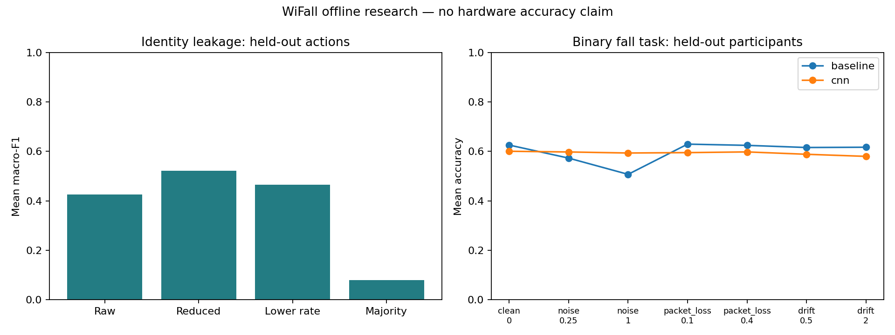

# M4 measured results

Local WiFall experiments, 2026-10-10. All means weight each held-out fold equally.

## Privacy leakage

Known dataset participants, held-out actions; five folds. Train-only scaling and balanced ridge classifiers; no recording crosses partitions.

| Representation | Mean accuracy | Mean macro-F1 |
|---|---:|---:|
| raw | 60.6% | 0.426 |
| reduced | 50.7% | 0.522 |
| lower_rate | 53.2% | 0.465 |
| majority_control | 67.5% | 0.081 |

Uniform chance is 10%, but the majority control reaches 67.5% accuracy because ID2 dominates the data. Macro-F1 reveals minority-class behavior. Reduced features retain identity-related information and score higher macro-F1 than raw windows here. Lower sampling rate is not a privacy guarantee. Participant labels may correlate with collection session or environment; these results do not validate biometric identification.

## Robustness

Fixed M3 binary-fall models, ten held-out participants, seven conditions. Perturbations are software-only. No test data is used to retrain models or fit the statistical anomaly reference.

| Model | Condition | Level | Accuracy | Macro-F1 | Flagged windows |
|---|---|---:|---:|---:|---:|
| baseline | clean | 0 | 62.5% | 0.594 | 0.1% |
| baseline | noise | 0.25 | 57.3% | 0.527 | 0.1% |
| baseline | noise | 1 | 50.7% | 0.380 | 100.0% |
| baseline | packet_loss | 0.1 | 62.9% | 0.597 | 0.1% |
| baseline | packet_loss | 0.4 | 62.4% | 0.585 | 0.1% |
| baseline | drift | 0.5 | 61.6% | 0.586 | 0.3% |
| baseline | drift | 2 | 61.7% | 0.582 | 57.2% |
| cnn | clean | 0 | 60.0% | 0.556 | 0.1% |
| cnn | noise | 0.25 | 59.8% | 0.553 | 0.1% |
| cnn | noise | 1 | 59.3% | 0.550 | 100.0% |
| cnn | packet_loss | 0.1 | 59.5% | 0.550 | 0.1% |
| cnn | packet_loss | 0.4 | 59.8% | 0.554 | 0.1% |
| cnn | drift | 0.5 | 58.8% | 0.536 | 0.3% |
| cnn | drift | 2 | 58.0% | 0.512 | 57.2% |

Noise is measured in training carrier standard deviations; drift ends at the stated multiple of that scale. Packet loss is a drop probability with last-frame hold; the first frame is retained. Perturbations can sometimes improve a weak model's score, so the table reports changes without assuming monotonic degradation.

Flagged windows are threshold exceedances, not gateway alert counts. Clean held-out windows can also be flagged. Anomalies indicate distribution changes, not intent, physical interference, or proven tampering. Gateway alerts require sustained evidence and are tested separately using synthetic signals.

Local provenance: `artifacts/m4/privacy-wifall-exported/` and `artifacts/m4/robustness-wifall-final/`. Research model weights and person-level predictions are not included in this aggregate report.
